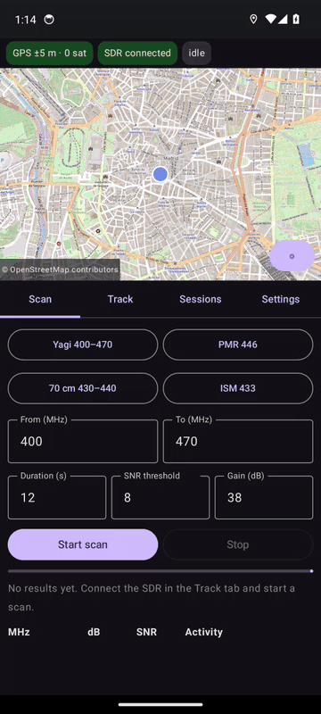
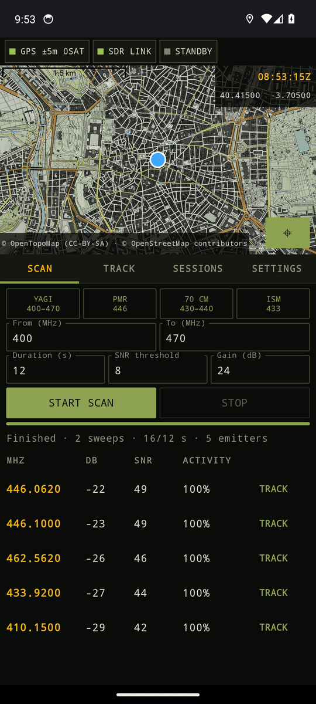
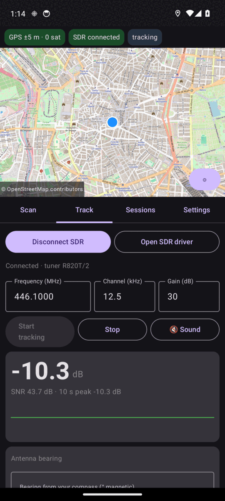
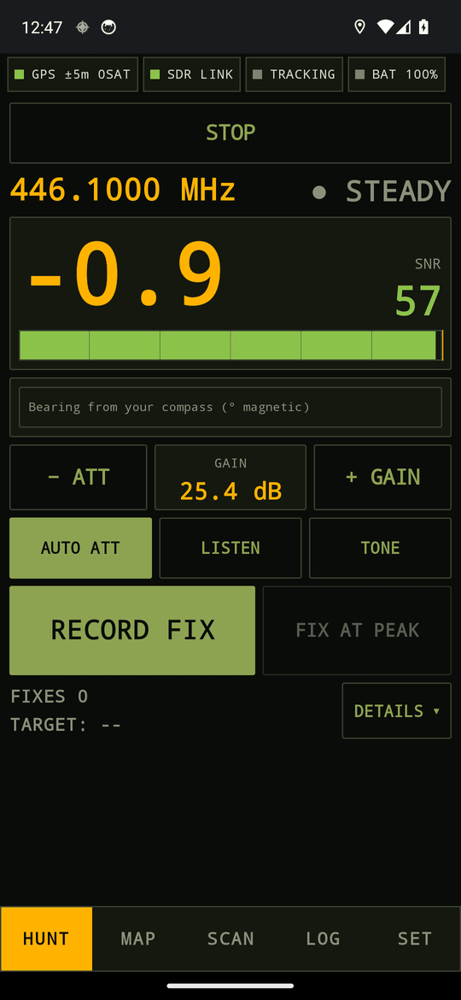
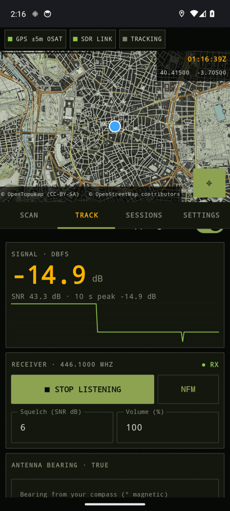
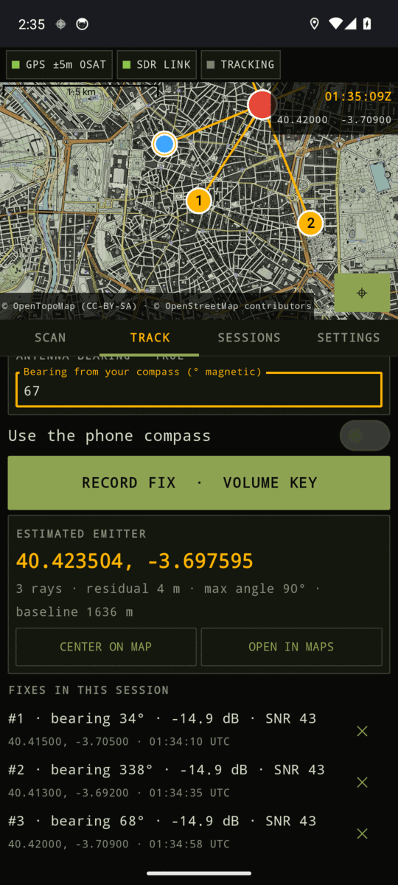
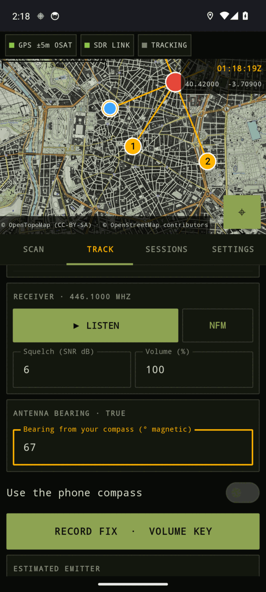
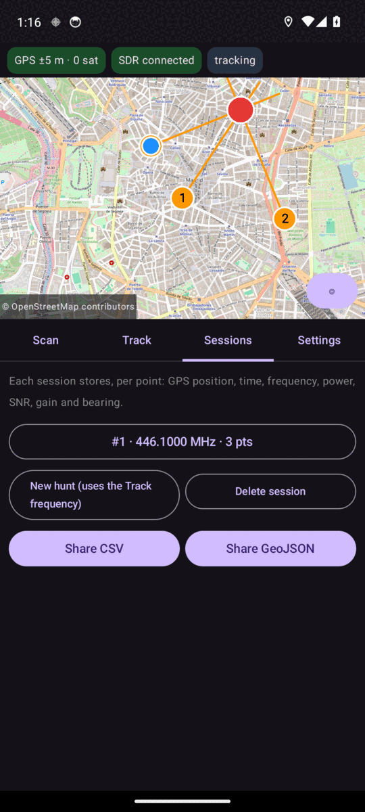
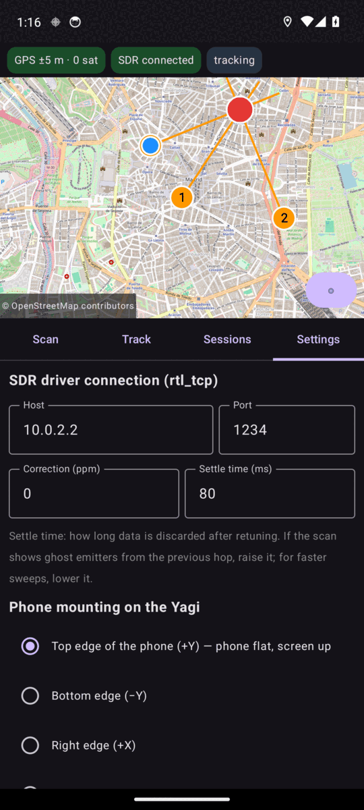
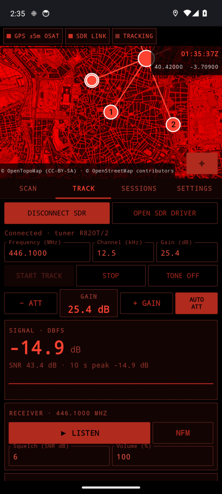

# rtl-df-android · Radio direction finding for Android (Kotlin)

<p align="center">
  
</p>

<p align="center"><sub>Demo recorded on the Android emulator against a synthetic <code>rtl_tcp</code> source (see <a href="#try-it-without-hardware">Try it without hardware</a>), sped up 3.5×: scan 400–470 MHz, track 446.100 MHz, a strong signal clips and auto-attenuate brings the gain down, listen to the channel, then record bearings from three positions and the emitter is located (residual 4 m on synthetic data).</sub></p>

Android app for locating transmitters with a Yagi antenna. The phone is mounted on the Yagi and acts as screen, GPS and compass; the RTL-SDR connects over USB OTG and is served by the **SDR driver** app (`rtl_tcp` on `127.0.0.1:1234`).

**Workflow**
1. **Scan**: sweeps 400–470 MHz (the range of the Ailunce AY02 Yagi) for the duration you choose and lists the active emitters with level, SNR and activity %. Presets: full Yagi range, PMR 446, 70 cm, ISM 433.
2. **Track**: pick an emitter from the list (or type a frequency). Live power as a number, a graph and an **audio tone** (higher pitch = stronger signal).
   - **Attenuate when you get close**: **− ATT** / **+ GAIN** change the tuner gain live, and **Auto-attenuate when clipping** steps it down by itself whenever the signal overloads the receiver (the red *CLIPPING* warning). The gain stored with each point is always the one in force when it was measured.
   - **Listen**: **▶ LISTEN** demodulates the tracked frequency (NFM for walkie-talkies and amateur radio, AM for airband) and plays it on the phone speaker. The squelch opens on the measured SNR; set its threshold and the volume next to the button.
   - **Sweep assist**: swing the Yagi through a full turn and the app bins power by compass heading and shows the strongest direction (`PEAK 130° true · +9 dB over average`). **RECORD FIX AT PEAK** stores a fix with that bearing instead of the instantaneous compass reading. It only enables once the lobe is clear (≥ 4 dB above the average direction and ≥ 60° of heading covered); clipped samples are ignored.
   - **Polar plot**: next to the signal reading, a north-up plot of the power seen at each heading, with the antenna needle (amber) and the peak (green).
3. **Record fix** (button or **volume key**): stores GPS position, time (GPS time), frequency, power, SNR, gain and bearing. The bearing comes from the phone compass, with magnetic declination computed automatically from the GPS position.
4. With 2 or more points it computes the emitter position (weighted least squares: bearings with higher SNR and better GPS count more) and draws it on the map with the rays and a **95% confidence ellipse**. With 4+ points, a bearing that clearly disagrees (reflection, wrong signal) is left out automatically and drawn dashed grey.

## Screenshots

| Scan | Track | Clipping → attenuated |
|:---:|:---:|:---:|
|  |  |  |
| Emitters found by a sweep: level, SNR, activity | Live power, graph and gain controls | Auto-attenuate stepped the gain down after clipping |

| Listen | Estimate | Map |
|:---:|:---:|:---:|
|  |  |  |
| Receiver panel: NFM/AM, squelch, volume | Estimated emitter and recorded fixes | Bearing lines, own position (blue), emitter (red) |

| Sessions | Settings | Night mode |
|:---:|:---:|:---:|
|  |  |  |
| Hunts, CSV and GeoJSON export | Map style (topographic by default), night mode | Red display that keeps your night vision |

## Build and install
1. Recent Android Studio (Ladybug or newer). **File → Open** and pick this folder; wait for the Gradle *Sync* (it downloads dependencies, so internet is needed once).
2. If Studio offers to upgrade AGP/Kotlin/Compose you can accept; the pinned versions are a known compatible set (AGP 8.7.3, Gradle 8.9, Kotlin 2.0.21).
3. Connect the phone with USB debugging and press **Run**, or **Build → Build APK(s)**.

From the command line (needs the Android SDK, e.g. `ANDROID_HOME` or a `local.properties` with `sdk.dir`):

```
./gradlew test            # JVM tests
./gradlew assembleDebug   # app/build/outputs/apk/debug/app-debug.apk
./gradlew lintDebug
```

## First use
1. Open **SDR driver**, plug in the RTL-SDR (accept the USB permission) and tap **Start** (host `127.0.0.1`, port `1234`).
2. Open this app and grant the location permission. In **Track** tap **CONNECT SDR** (there is also a button to open SDR driver).
3. Go to **Scan** → **START SCAN**.

While a scan or track is running the app shows an ongoing notification (a foreground service), so Android keeps capture and GPS alive if you switch to SDR driver or lock the screen.

Tips: enable **airplane mode** in the field (GPS keeps working and the phone radios will not interfere with the RTL-SDR), and keep the screen on: the app holds it awake because capture stops if the screen turns off.

## Mounting the phone on the Yagi
- Place the phone **flat** on the boom with its top edge pointing forward (the default). If you mount it differently, choose the axis in **Settings → Phone mounting**.
- A parametric printable mount is in [`hardware/`](hardware/README.md). Print it in **PETG/PLA with no metal or magnets** (steel screws, magnetic mounts…): they disturb the compass. Keep it as far from the dongle and the boom as you can.
- Calibrate the compass by moving the phone in a figure 8 with the mount in place (the Track tab shows the calibration level).
- **Bearing offset**: point the Yagi at something with a known bearing and enter the difference in Settings (it compensates for the phone not being perfectly aligned).
- **Volume keys** record the point without touching the screen; the app averages the bearing over the 2.5 s before the key press (pressing moves the antenna).

## Map and display
**Settings → Map style** switches between **Topographic** (OpenTopoMap, the default: contours and terrain, useful for line of sight) and **Street** (OpenStreetMap). Tiles are cached per style. **Night mode** turns the whole display (and the map) red-on-black so it does not ruin your night vision in the field.

## Offline map
Frame your work area on the map (the download uses the selected map style) and, in **Settings → Offline map**, tap **DOWNLOAD VISIBLE AREA** (zoom 12–16 by default, capped at 2000 tiles by the tile servers' usage policies). Then enable **Offline-only map**. Tiles are stored on the phone.

## Useful settings
- **Settle time (ms)**: time discarded after retuning, needed because `rtl_tcp` streams continuously. At 80 ms a 70 MHz sweep takes about 8 s. If ghost emitters from the previous hop appear, raise it; for faster sweeps, lower it.
- **ppm**: RTL-SDR frequency correction (cheap dongles drift by tens of kHz).
- Empty gain or `auto` = tuner AGC. When tracking, start around 30 dB and lower it if "Signal clipping" shows up. Powers are relative dBFS (uncalibrated): good for comparing points taken with the same gain. Close to the emitter, lower the gain (**− ATT**, or auto-attenuate): a clipped signal reads wrong. If it still clips at minimum gain, move away or add an external attenuator.

## Verification status
- `./gradlew test assembleDebug lintDebug` pass (Gradle 8.9, AGP 8.7.3, Kotlin 2.0.21, compileSdk 35): no compile errors, no Kotlin warnings, no lint errors.
- The core logic (`rtl_tcp` client, DSP, scanner, tracker, geometry) passes 11 JVM tests against a fake `rtl_tcp` server (`app/src/test`): it detects carriers to within ±3 kHz, measures SNR and locates the emitter to within metres on synthetic data.
- The whole app was run on an Android 14 emulator against a synthetic `rtl_tcp` source: connect, scan (5 of 5 synthetic emitters found), track, live attenuation (the fake source clips at high gain), listening, record three points with mock GPS, estimate and map overlays, sessions, settings and night mode. The osmdroid map loads tiles and draws the rays correctly.
- The demodulator has JVM tests with synthetic NFM and AM signals (tone recovery, squelch, adjacent-channel rejection). Audio playback was checked on the emulator only (the AudioTrack runs without errors); how it sounds with real speech has not been judged.
- **Not tested on real hardware:** a real RTL-SDR with SDR driver, the phone compass on a Yagi (the emulator demo uses typed bearings), voice quality on real signals, real GPS, USB OTG behaviour, and the offline tile download. The settle time and the behaviour of SDR driver may need tuning.

## Try it without hardware
`tools/fake_rtl_tcp.py` is a small `rtl_tcp` server that streams synthetic carriers (433.920, 446.0625, 446.100, 462.5625 and 410.150 MHz). With the emulator running:

```
python3 tools/fake_rtl_tcp.py 1234 /tmp/level      # optional file with a 0..1 level for the 446.100 MHz carrier
```

In the app, set **Settings → SDR driver connection → Host** to `10.0.2.2` (the emulator's alias for the host machine), then **CONNECT SDR** in the Track tab. Mock GPS positions come from `adb emu geo fix <lon> <lat>`; switch off **Use the phone compass** and type the bearings. Changing the level file while tracking simulates sweeping the antenna.

## Known limitations
- Listening is mono NFM/AM only (no wide FM, no digital voice such as DMR or P25), and you are responsible for complying with local rules on monitoring radio communications.
- No automatic SDR reconnection: if the socket drops, tap **CONNECT SDR** again.
- The compass "not calibrated" warning relies on the sensor's reported accuracy, which some phones report poorly for the rotation vector.
- Offline map downloads show start and end messages but no progress bar.

## Structure
| File | Purpose |
|---|---|
| `RtlTcp.kt`, `Sdr.kt` | rtl_tcp protocol, configuration, tuning and capture without stale data |
| `Dsp.kt` | FFT, averaged spectrum, median, percentiles |
| `Scanner.kt` | hop-based sweep, maxima, activity %, grouping into emitters |
| `Tracker.kt` | live power and SNR; point power = 90th percentile over 3 s |
| `PeakFinder.kt` | sweep assist: power vs. heading bins, main-lobe bearing, reliability |
| `Geo.kt` | intersection / least squares of bearings |
| `Sensors.kt` | GPS (LocationManager), compass (rotation vector), declination |
| `Db.kt`, `Export.kt` | SQLite, shareable CSV and GeoJSON |
| `Demod.kt` | NFM/AM voice demodulator and speaker output (taps the IQ stream) |
| `Theme.kt` | tactical theme: palette, night mode, square buttons and panels |
| `CaptureService.kt` | foreground service that keeps capture and GPS alive in the background |
| `tools/fake_rtl_tcp.py` | synthetic `rtl_tcp` source for demos and emulator testing |
| `MainViewModel.kt`, `Ui.kt`, `MapOverlays.kt`, `MainActivity.kt` | state, Compose UI, map, volume keys |

JVM tests: `./gradlew test` (or *Run tests* in Android Studio).
