# How to use RDF Finder

A field guide: from plugging in the dongle to a position on the map. The screenshots come from the emulator demo against a synthetic signal source, so the numbers are illustrative.

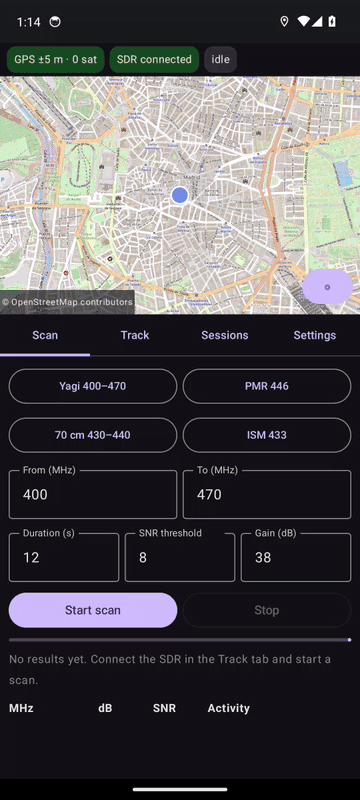

## Quick start (10 steps)
1. Plug the RTL-SDR into the phone, open **SDR driver**, accept the USB permission and tap **Start**.
2. Open **RDF Finder** and grant location (and notification) permission.
3. **HUNT** screen → **CONNECT SDR**. Wait for the `GPS` chip to show a small error (±5–10 m).
4. **SCAN** → pick a preset → **START SCAN**.
5. Tap **TRACK** on the emitter you want.
6. **START TRACK** (the same big button on HUNT). Point the antenna around; the signal peaks when it points at the fox.
7. Close to the fox, lower the gain (**− ATT** or **AUTO ATT**) so the signal does not clip.
8. Sweep the antenna through a full turn and tap **FIX AT PEAK** (or **RECORD FIX** / a volume key).
9. Move 200–500 m to another place, at a different angle, and record again. Three or more fixes give a good estimate.
10. Read the **estimated emitter**, **target distance** and **next fix**, walk to it, and keep refining.

## What you need
- An Android phone (8.0+) with GPS and a compass, and a USB OTG adapter.
- An RTL-SDR dongle and a directional antenna (tuned for a 400–470 MHz Yagi).
- The **SDR driver** app (it serves the dongle as `rtl_tcp` on `127.0.0.1:1234`).
- The APK from the [Releases page](https://github.com/AlbertAmat/rtl-df-android/releases) (allow "install unknown apps" when asked).

## 1. Set up (once per session)
1. Plug the RTL-SDR in. Open **SDR driver**, accept the USB permission and tap **Start** (host `127.0.0.1`, port `1234`).
2. Open **RDF Finder** and grant the permissions.
3. On the **HUNT** screen tap the big **CONNECT SDR** button. The header shows chips for GPS, SDR link, mode and battery.
4. In the field, switch on airplane mode (GPS keeps working) and keep the screen on.

Mount the phone flat on the boom with its top edge pointing forward, and calibrate the compass by moving the phone in a figure 8 (see *Mounting the phone* in the [README](../README.md)).

## 2. Find the signal: SCAN tab
| Scan running | Results |
|:---:|:---:|
| 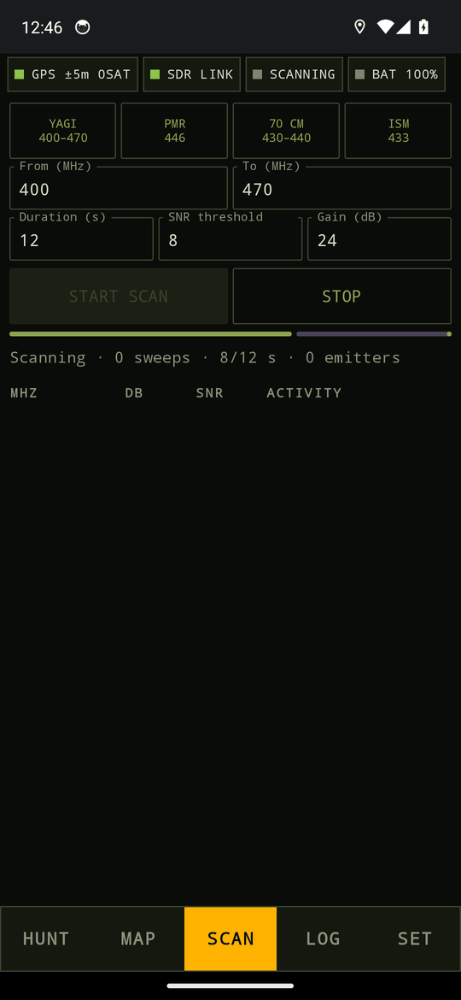 | 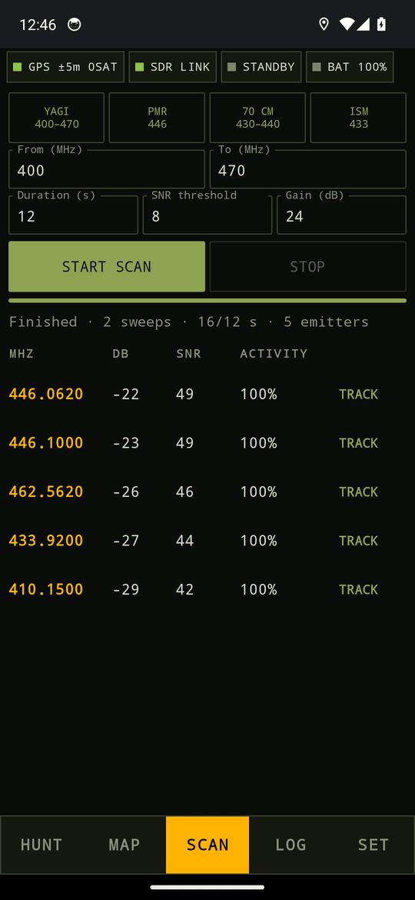 |

1. Pick a preset (Yagi range, PMR 446, 70 cm, ISM 433) or type **From / To** in MHz.
2. Set the **duration** (seconds) and the **SNR threshold**. Longer scans catch intermittent transmitters.
3. Tap **START SCAN**. Emitters appear with level (dB), SNR and **activity %** (how often they were on air). A name you saved for a frequency shows under it.
4. Tap **TRACK** on the row you want. The frequency is copied to the Hunt screen.

## 3. Follow it: HUNT screen

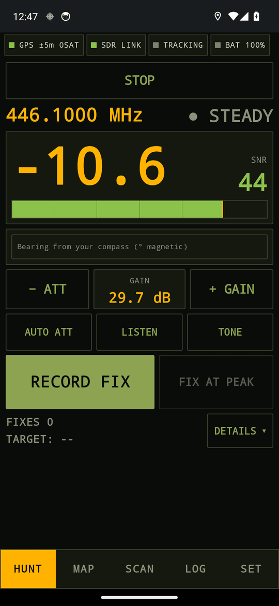

Everything you touch while walking is on this one screen, with no scrolling:
1. **Big button at the top:** **CONNECT SDR**, then **START TRACK** (it shows the frequency), then **STOP**.
2. **Frequency and trend:** **▲ HOTTER / ▼ COLDER** compares the last 3 s with the 4 s before.
3. **Signal:** the big number is power in dBFS, with the SNR beside it. The bar shows level from −60 to 0 dB with an amber peak tick. A red **CLIPPING** line means the receiver is overloaded.
4. **Bearings:** **HEADING** is where the antenna points (true north), **PEAK** is the strongest direction found while you sweep, and the small plot shows power by heading. With **Use the phone compass** off, you type the bearing here instead.
5. **− ATT / gain / + GAIN** change the tuner gain live.
6. **AUTO ATT**, **LISTEN** and **TONE** are toggles (filled = on). **TONE** is a beeper: higher pitch means a stronger signal.
7. **RECORD FIX** (or a volume key) stores a fix; **FIX AT PEAK** stores one at the sweep peak.
8. Under the buttons: the number of fixes and the **TARGET** distance and bearing once there is an estimate.
9. **DETAILS** opens the rest below: frequency, channel width and gain fields, fox name, history and waterfall, fox status, compass and sweep details, receiver, estimate and fixes.

 

Set **Frequency (MHz)**, **Channel (kHz)** (12.5 for narrow FM) and **Gain (dB)** (start near 30) under DETAILS, or pick the emitter on the SCAN screen. Type a **Fox name / notes** there too; it is remembered for that frequency.

### Fox status: hotter / colder, timed foxes, drift
Under DETAILS:
- **▲ HOTTER / ▼ COLDER** compares the last 3 s with the 4 s before. **VOICE ON** speaks "hotter", "colder" and the SNR, so the phone can stay in your pocket.
- **TIMED FOX · every N s · next in M s** appears after three regular bursts, so you know when to measure.
- **CARRIER +x kHz** shows how far the carrier is from the tuned frequency. Above 1.5 kHz, tap **RETUNE** (cheap dongles drift); the hunt continues.

### When you get close: attenuate
| Clipping | Attenuated |
|:---:|:---:|
| 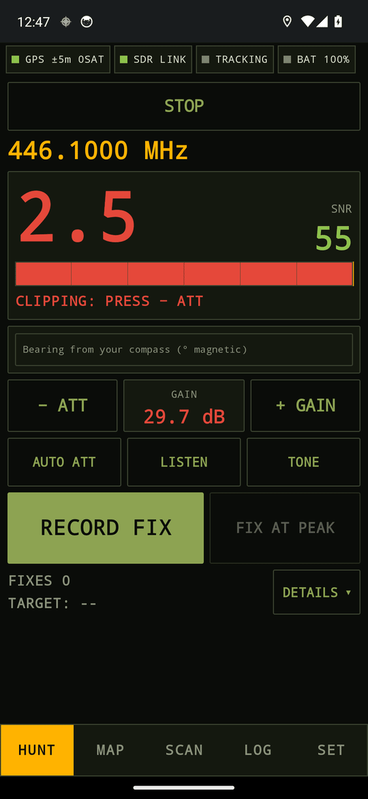 | 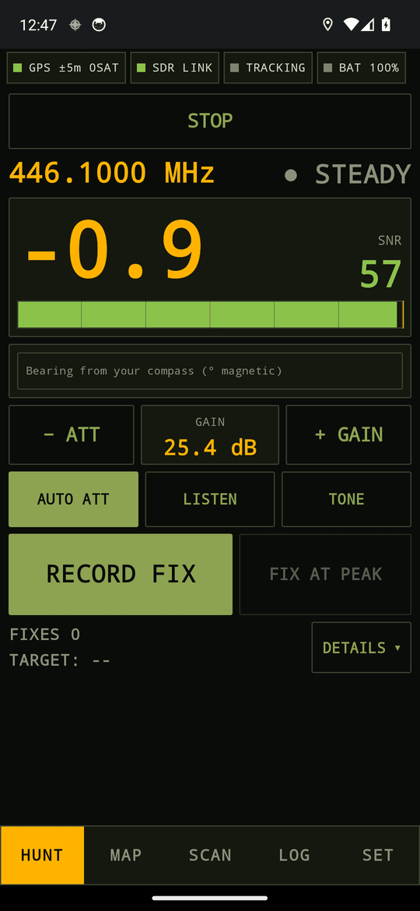 |

A strong signal overloads the receiver and the reading becomes wrong. When you see the red **⚠ CLIPPING**:
1. Tap **− ATT** to lower the gain (**+ GAIN** raises it), or
2. switch on **AUTO ATT** (filled = on) and the app lowers the gain by itself.

If it still clips at the lowest gain the app shows **MIN GAIN: ADD AN EXTERNAL ATTENUATOR**. Put a 10–20 dB attenuator between the antenna and the dongle, or step back. Points store the gain that was active when they were measured.

### Listen to the channel

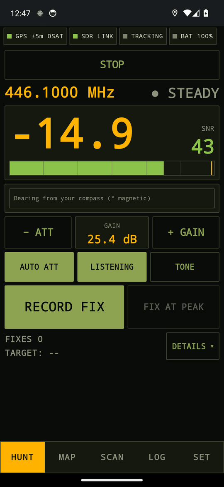

1. Tap **LISTEN** on the Hunt screen to hear the frequency on the phone speaker.
2. Under DETAILS → **RECEIVER**, tap the mode button to cycle **NFM** (walkie-talkies), **AM** (airband), **USB / LSB** (amateur SSB) and **CW** (Morse, 700 Hz tone). For SSB and CW use a narrow channel width.
3. Raise the **squelch** (SNR dB) in the same panel if you hear hiss.
4. Tap **LISTENING** again to stop.

Check your local rules on monitoring radio communications.

 

## 4. Get the bearing and record a fix
Two ways:
- **Sweep assist (recommended):** swing the antenna slowly through a full turn. **PEAK** shows the strongest direction. When the lobe is clear, **FIX AT PEAK** enables. A **MULTIPATH?** warning means a second lobe is nearly as strong: reflections are likely, so rely on the crossing of fixes from different places, not on one bearing.
- **Manual:** point the antenna at the strongest signal and press **RECORD FIX** (or a volume key; the bearing is averaged over the 2.5 s before the press). With **Use the phone compass** off you type the bearing yourself.

Each fix stores position, time, frequency, power, SNR, gain and bearing. A fix is refused if there is no carrier (SNR below 3 dB). Warnings appear for low SNR, poor GPS accuracy, clipping and an uncalibrated compass.

## 5. Locate it
| Estimate (DETAILS) | Hunt with fixes | MAP |
|:---:|:---:|:---:|
| 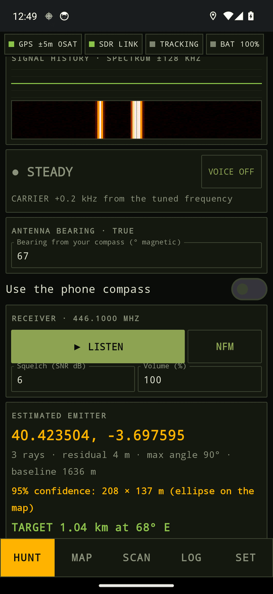 | 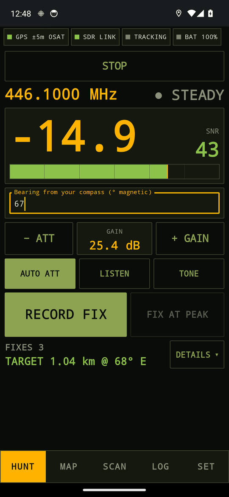 | 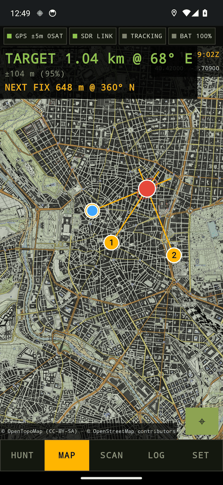 |

1. Record at least **two** fixes from different places, ideally **three or more**, with angles far apart (e.g. 90°). Walking 200–500 m between fixes is typical.
2. The **ESTIMATED EMITTER** panel shows the coordinates, residual and a **95% confidence ellipse**. The **MAP** screen shows the rays (amber), your position (blue) and the emitter (red), with the target and next fix at the top.
3. With 4+ fixes, a clearly inconsistent bearing (reflection, wrong signal) is dropped and shown dashed grey.
4. With a GPS fix the panel adds **TARGET distance and bearing** from where you stand and a **Next fix** suggestion: the spot around the estimate that crosses the earlier views best, nearest to you. **OPEN NEXT FIX IN MAPS** (in the estimate under DETAILS) navigates there.
5. Each fix in the list (DETAILS) shows a quality score **Q %** (from its SNR and GPS accuracy); tap ✕ to delete a bad one.
6. **CENTER ON MAP** zooms to the result; **OPEN IN MAPS** hands the coordinates to your navigation app.
7. Walk toward the estimate, track again and record new fixes to refine it. Close in, keep an eye on clipping.

## 6. Save and share: LOG tab

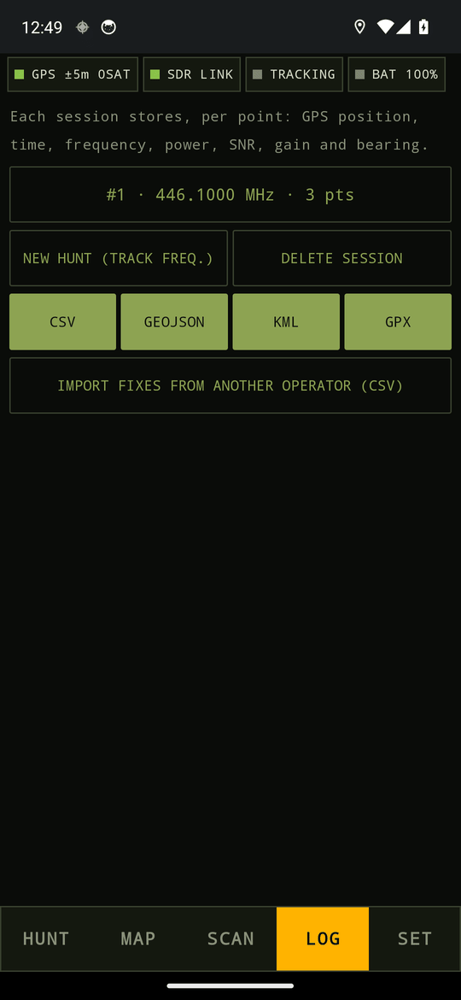

Each hunt is a session.
1. Pick a session from the drop-down to review it, or tap **NEW HUNT (TRACK FREQ.)** to start a fresh one.
2. **CSV**, **GEOJSON**, **KML** (Google Earth) and **GPX** (GPS apps) share the fixes and the estimate.
3. **IMPORT FIXES FROM ANOTHER OPERATOR** reads a CSV exported by another phone into the current hunt (duplicates are skipped), so two teams' bearings give one estimate. Make sure both hunts use the same frequency.

 

## 7. Settings (SET tab)

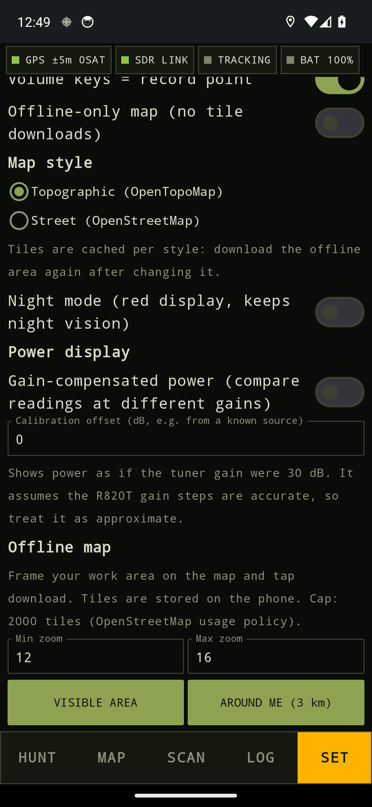

| Setting | What it does |
|---|---|
| Map style | Topographic (default) or Street |
| Night mode | Red-on-black display that keeps night vision |
| Use the phone compass | Off = type bearings by hand |
| Bearing offset | Compensates for the phone not being aligned with the antenna |
| Phone mounting | Which phone axis points along the boom |
| Volume keys = record point | Record a fix without touching the screen |
| ppm | Frequency correction for cheap dongles |
| Settle time (ms) | Raise it if ghost emitters from the previous hop appear |
| Gain-compensated power | Shows power as if the gain were 30 dB, plus an offset you enter (approximate, not calibrated) |
| Offline map | **VISIBLE AREA** or **AROUND ME (3 km)**, with a progress bar, then enable offline-only |

 

### Night mode
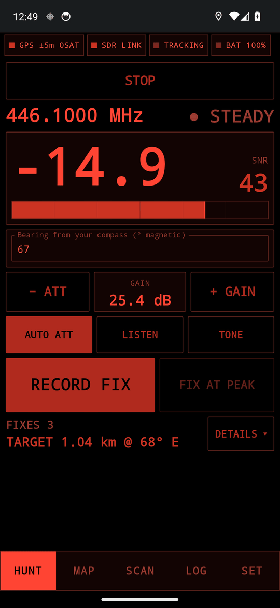

Turn it on in Settings before you start in the dark; everything, including the map, goes red.

## Troubleshooting
| Symptom | Try |
|---|---|
| CONNECT SDR fails | Is SDR driver running with the dongle started on port 1234? Tap **OPEN SDR DRIVER** and start it first. |
| Connection drops | The app reconnects by itself for about two minutes and resumes tracking. After that tap **CONNECT SDR**. |
| No emitters in the scan | Lower the SNR threshold, lengthen the duration, check the antenna, try a gain around 24–30 dB. |
| Reading flat at the top, CLIPPING | Lower the gain (− ATT or AUTO ATT), or move away. |
| Bearings jump around | Calibrate the compass (figure 8), keep metal and magnets away from the phone, use sweep assist. |
| Estimate far off | Fixes too close together or at similar angles; take more, from different directions. Check GPS accuracy. |
| Sound is only hiss | Raise the squelch SNR, or switch NFM/AM. |
| Header shows BAT low | Capture and GPS drain the battery: use a power bank and save your fixes. |
| Capture stops when the screen turns off | Keep the screen on (the app holds it awake) and leave the capture notification in place. |
